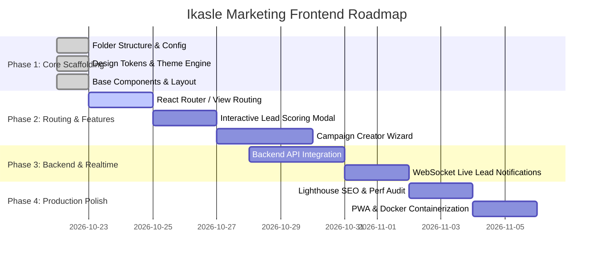

# Ikasle Marketing — Frontend Implementation Plan

## 1. Project Overview & Objectives
**Ikasle Marketing** is a high-performance marketing and student acquisition platform designed for educational institutions, bootcamps, and training academies. The platform enables marketing teams and admission counselors to track campaigns across Google Ads, Meta, LinkedIn, and campus outreach, score student leads, and monitor funnel conversion velocity.

---

## 2. Technology Stack & Architectural Decisions

| Layer | Selected Tech | Justification |
| :--- | :--- | :--- |
| **Framework / Runtime** | [React 19](https://react.dev) + [TypeScript](https://www.typescriptlang.org) | Modern type-safety, concurrent rendering, and zero-runtime type errors |
| **Build Tool & Bundler** | [Vite 8](https://vitejs.dev) | Instant HMR, fast production bundling via Rollup/esbuild |
| **Design System & CSS** | Custom CSS Variables + Glassmorphism Tokens | Maximum control, zero CSS runtime overhead, dark/light mode native support |
| **Icons** | [Lucide React](https://lucide.dev) | Clean, tree-shakeable SVG icon library matching modern SaaS aesthetics |
| **API Client** | Typed HTTP Client (`services/api.ts`) | Centralized auth interceptors, query parameter builders, error handling |
| **State Management** | React Context (`ThemeContext`, `AuthContext`) + Hooks | Lightweight, clean separation of concerns without unnecessary Redux overhead |

---

## 3. Directory & Folder Structure (Implemented)

```
d:/Ikasle Marketting/
├── public/                     # Static public assets (favicons, logos)
├── src/
│   ├── assets/                 # SVGs, icons, illustrations, media
│   │   ├── icons/
│   │   └── images/
│   ├── components/             # Reusable UI & Layout Components
│   │   ├── common/             # Atomic design elements (Button, Card, Badge, Input, Modal)
│   │   │   ├── Button.tsx
│   │   │   ├── Card.tsx
│   │   │   └── Badge.tsx
│   │   ├── feedback/           # Alert, Toast, Skeleton Loader, EmptyState
│   │   ├── forms/              # Form controls, InputField, SelectDropdown
│   │   └── layout/             # Shell components
│   │       ├── Navbar.tsx      # Top sticky header with search, theme switch & user profile
│   │       ├── Sidebar.tsx     # Navigation sidebar with active tabs & counts
│   │       └── AppLayout.tsx   # Responsive wrapper container
│   ├── context/                # Global state providers
│   │   └── ThemeContext.tsx    # Dark/light mode theme management
│   ├── features/               # Feature-specific modules (optional granular split)
│   │   ├── analytics/
│   │   ├── campaigns/
│   │   ├── leads/
│   │   └── students/
│   ├── hooks/                  # Custom reusable React hooks
│   │   ├── useDebounce.ts      # Debounce input for real-time search
│   │   └── useLocalStorage.ts  # Persistent browser state synchronizer
│   ├── pages/                  # Page-level view containers
│   │   ├── DashboardPage.tsx   # KPI cards, funnel metrics, and recent student inquiries
│   │   ├── LeadsPage.tsx       # Student lead pipeline table with filtering & scoring
│   │   ├── CampaignsPage.tsx   # Ad campaign cards with budget progress and CPL metrics
│   │   ├── AnalyticsPage.tsx   # Channel attribution & course conversion analytics
│   │   └── SettingsPage.tsx    # Ad account integrations & scoring threshold settings
│   ├── routes/                 # Routing definitions & route guards
│   ├── services/               # HTTP API integration layer
│   │   ├── api.ts              # Fetch client with token header handling
│   │   └── leadService.ts      # Mock & backend API service for leads & KPIs
│   ├── styles/                 # Global styling architecture
│   │   ├── variables.css       # Design tokens, color palette, shadows, radii
│   │   └── index.css           # Global reset, typography, and glass utilities
│   ├── types/                  # TypeScript interface contracts
│   │   └── index.ts            # User, Lead, Campaign, MetricSummary
│   ├── utils/                  # Helper utilities & constants
│   │   ├── constants.ts        # App configuration & status pill mappings
│   │   └── formatters.ts       # Currency, date, and percentage formatters
│   ├── App.tsx                 # Core application controller & active view switcher
│   └── main.tsx                # React DOM mount point
├── index.html                  # HTML5 entry with SEO tags & font preconnects
├── package.json                # Project dependencies and npm scripts
├── tsconfig.json               # TypeScript compiler config
└── vite.config.ts              # Vite build configuration
```

---

## 4. Multi-Phase Implementation Roadmap



### Phase 1: Foundational Scaffolding (Completed)
- [x] Vite 8 + React 19 + TypeScript initialization.
- [x] Complete production folder structure (`components/`, `pages/`, `services/`, `hooks/`, `context/`, `styles/`, `types/`, `utils/`).
- [x] Modern dark/light design token system with glassmorphic cards and typography.
- [x] Shell layout: [Navbar.tsx](file:///d:/Ikasle%20Marketting/src/components/layout/Navbar.tsx), [Sidebar.tsx](file:///d:/Ikasle%20Marketting/src/components/layout/Sidebar.tsx), and [AppLayout.tsx](file:///d:/Ikasle%20Marketting/src/components/layout/AppLayout.tsx).
- [x] Production build validation passing with 0 TypeScript/ESLint errors.

### Phase 2: Feature Expansion & Interactive Views
- [ ] Implement client-side routing using `react-router-dom` (or keeping lightweight state-based view switching if single-page dashboard preferred).
- [ ] Add "New Lead" modal form with validation using `zod` or custom validators.
- [ ] Multi-step "New Campaign" creation wizard with budget pacing inputs.
- [ ] CSV / Excel export for student leads list.

### Phase 3: Backend Connection & Authentication
- [ ] Connect `services/api.ts` to backend REST or GraphQL API (e.g. Node.js/Express, NestJS, or FastAPI).
- [ ] Auth guard with JWT token handling, login/signup view, and session expiry refresh.
- [ ] WebSocket integration for real-time lead notification pings.

### Phase 4: Performance & Production Deployment
- [ ] Code splitting with `React.lazy` and `Suspense`.
- [ ] Production bundling & asset caching optimization.
- [ ] CI/CD workflow and Dockerfile for containerized deployment.

---

## 5. Key File Links

- [App.tsx](file:///d:/Ikasle%20Marketting/src/App.tsx)
- [Navbar.tsx](file:///d:/Ikasle%20Marketting/src/components/layout/Navbar.tsx)
- [Sidebar.tsx](file:///d:/Ikasle%20Marketting/src/components/layout/Sidebar.tsx)
- [DashboardPage.tsx](file:///d:/Ikasle%20Marketting/src/pages/DashboardPage.tsx)
- [LeadsPage.tsx](file:///d:/Ikasle%20Marketting/src/pages/LeadsPage.tsx)
- [CampaignsPage.tsx](file:///d:/Ikasle%20Marketting/src/pages/CampaignsPage.tsx)
- [variables.css](file:///d:/Ikasle%20Marketting/src/styles/variables.css)
- [types/index.ts](file:///d:/Ikasle%20Marketting/src/types/index.ts)
